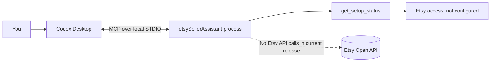
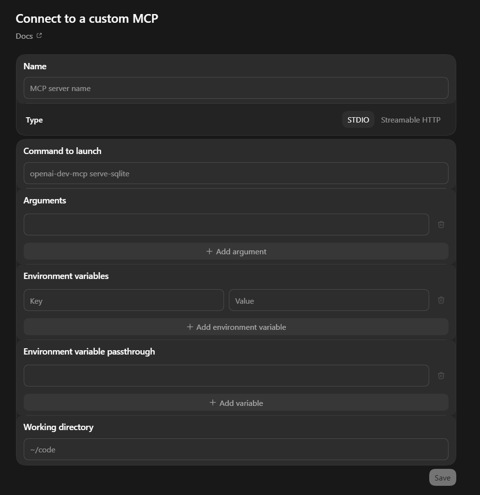

# etsySellerAssistant

A local-first MCP assistant for Etsy sellers to review listings and draft improvements. It is designed for Codex Desktop over local STDIO, with read-only access first and explicit approval required for any future edits.

## Current status

The default MCP server remains status-only. A separate **private Mac alpha** entry point provides
read-only listing tools after local setup and owner authorization. A bounded live Mac smoke test
successfully verified the configured shop and read one active listing; Codex Desktop acceptance and
Windows verification remain open. No listing mutation tools are exposed.

The alpha's separate entry point is `dist/src/alpha.js` after `npm run build`. See the
[Mac alpha review and test plan](docs/mac-alpha-review.md) before using it. Etsy documentation MCP
and this project's local shop-connected MCP server are separate connections.

## Supported platforms

- Windows 10/11 (x64)
- macOS (Apple Silicon or Intel)
- Node.js 24 or 26 LTS with npm 10 or later

Both Windows and macOS are supported development and runtime targets. This alpha has been live-tested
only on macOS; its Windows credential store, browser handoff, and live behavior remain unverified.
Use the path format and Node installation available on the computer where the MCP client runs.

## How it works today

Codex Desktop starts the MCP server as a local process and exchanges messages over standard input/output (STDIO). The current server only reports setup status; there is no Etsy network connection.



## First-time setup

### 1. Install prerequisites

Install Git and Node.js 24 or 26 LTS from a trusted source or version manager. The same terminal commands work in PowerShell, Command Prompt, and macOS Terminal:

```sh
git --version
node --version
npm --version
```

Confirm Node reports version 24.x or 26.x and npm reports version 10 or later. Codex Desktop needs to be able to start the same Node installation. If you install Node while Codex is open, restart Codex Desktop before configuring the server.

### 2. Clone the repository

Choose a folder where you keep development projects, then run:

```sh
git clone https://github.com/stevenfarmer/etsySellerAssistant.git
cd etsySellerAssistant
```

### 3. Install, validate, and build

Run these commands from the repository root:

```sh
npm ci
npm run validate
npm run build
```

- `npm ci` installs exactly the dependency versions recorded in `package-lock.json`.
- `npm run validate` checks formatting, lint, TypeScript types, and automated tests. It does not connect to Etsy.
- `npm run build` creates the JavaScript entry point Codex will launch at `dist/src/index.js`.

### 4. Add the server in Codex Desktop

Open the Codex Desktop custom MCP setup form, choose **STDIO**, and fill in the fields as follows. The exact menu labels can vary between Codex Desktop versions.

| Form field                           | Value                                                                    |
| ------------------------------------ | ------------------------------------------------------------------------ |
| **Name**                             | `etsySellerAssistant`                                                    |
| **Type**                             | **STDIO**                                                                |
| **Command to launch**                | `node`                                                                   |
| **Arguments**                        | Add one argument: the absolute path to `dist/src/index.js` in your clone |
| **Environment variables**            | Leave empty                                                              |
| **Environment variable passthrough** | Leave empty                                                              |
| **Working directory**                | The absolute path to the repository root, `etsySellerAssistant`          |

Example entry-point paths (replace the sample user and folder with your own):

- Windows: `C:\Users\YOUR_USER\source\etsySellerAssistant\dist\src\index.js`
- macOS: `/Users/YOUR_USER/code/etsySellerAssistant/dist/src/index.js`

Enter the executable and the script path in separate fields: put `node` in **Command to launch**, then add the script path as a single **Argument**. Do not paste the whole command into one field.

If Codex cannot find `node`, find its full path in a terminal and use that path for **Command to launch**:

- PowerShell: `(Get-Command node).Source`
- macOS Terminal: `command -v node`

The screenshot shows where these fields appear in the custom MCP form. Its visible command is placeholder text; do not copy it.



### 5. Confirm it is connected

Save the configuration, then start or reopen a Codex chat and inspect the available tools for `etsySellerAssistant`. Call `get_setup_status`. A successful response should say Etsy access is not configured.

No Etsy API key, OAuth setup, OpenAI API key, hosted service, or environment variable is needed for this scaffold.

## Updating or removing the server

To update your local checkout:

```sh
git pull
npm ci
npm run validate
npm run build
```

If the repository path changes, update **Arguments** and **Working directory** in the Codex Desktop server entry. To remove the integration, open Codex Desktop's MCP/custom server settings and remove the `etsySellerAssistant` entry. The settings location and button labels can vary by app version.

## Troubleshooting

| What you see                                    | What to check                                                                                                                                         |
| ----------------------------------------------- | ----------------------------------------------------------------------------------------------------------------------------------------------------- |
| `node` is not found                             | Confirm `node --version` works in a terminal. Restart Codex Desktop after installing Node, or use the full executable path for **Command to launch**. |
| The server does not start                       | Run `npm ci` and `npm run build` from the repository root. Confirm the argument points to the resulting `dist/src/index.js`.                          |
| The configured path is rejected                 | Use an absolute path in the operating system's native format. Check for typos and confirm the file exists.                                            |
| The working directory is invalid                | Set it to the cloned repository root, the folder containing `package.json`.                                                                           |
| Running `npm start` in a terminal seems to wait | This is expected. The STDIO MCP server waits for a client such as Codex Desktop. Stop the process with Ctrl+C.                                        |
| The tool is missing in Codex                    | Confirm the configuration was saved, restart Codex Desktop, and check that the server's command, argument, and working directory are correct.         |

## Project documentation

- [Architecture, data boundaries, and future design](docs/architecture.md)
- [Seller App registration and OAuth verification (T-007)](docs/etsy-registration-verification.md)
- [Approved next phase plan and remaining gates](docs/next-phase-plan.md)
- [Development guide](docs/development.md)
- [Contributing](CONTRIBUTING.md)
- [Security reporting](SECURITY.md)
- [Architecture decisions](docs/decisions/)

## License

GNU Affero General Public License v3.0. See [LICENSE](LICENSE).
