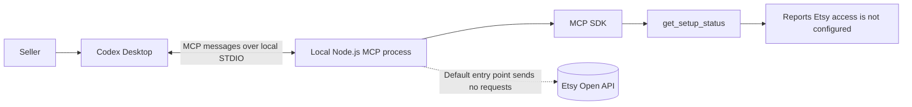
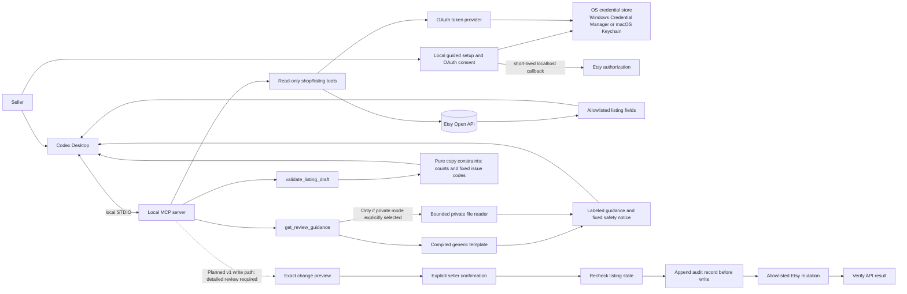
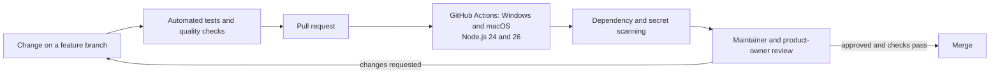

# Architecture

## Current implementation

The default entry point is a local MCP process over STDIO with one status tool and no Etsy network
calls. The separate `dist/src/alpha.js` entry point exposes bounded read-only listing tools for one
locally configured, owner-authorized shop, plus explicit review guidance (generic by default,
private only by opt-in client configuration) and local bounded title/description/tag preflight. On the Mac, an owner-authorized listing and detail smoke
test passed. v1 targets macOS with Codex Desktop. Windows is deferred to v2 or later; Linux is exploratory.

The diagram shows the default status-only entry point. The MCP SDK owns protocol framing;
application/domain logic stays separate from MCP schemas and can be tested without a desktop client.

The read-server status displays only allowlisted identity and time from a complete successful listing read in this process. It performs no settings/credential/network I/O; pending/failed reads or restart clear confirmation. See [current requirements/use cases/acceptance](requirements-and-acceptance.md) for current evidence and task states.

## Etsy boundary

The alpha uses Etsy's official Open API and `listings_r` authorization, restricted to the configured,
seller-authorized shop. The owner-authorized Mac OAuth round trip and bounded live read succeeded.

The read-only path is implemented in the alpha. The dotted mutation path is a v1 requirement
under ADR 0005, pending detailed security/design review. It is not implemented; live writes
are not authorized by this planning decision.

The owner approved guarded edits as a v1 requirement in [ADR 0005](decisions/0005-v1-intelligence-and-guarded-edits.md); detailed write-access design/security review remains required before implementation. Any such feature must be limited to approved listing fields, show exact before/after values, require explicit confirmation for the selected listing, check for stale data, verify the API result, and write a local audit record before mutation. No generic endpoint execution, listing deletion, publishing, order access, or buyer data access is permitted by default.

## Platform and local data design

v1 supports macOS with Codex Desktop. Later releases verify other local STDIO clients, then Windows (v2 or later); Linux remains exploratory. Use Node's platform-neutral path APIs and explicit local configuration. Existing Windows CI and adapters remain regression coverage and future groundwork, not evidence of runtime support.

Credentials use macOS Keychain or Windows Credential Manager through a protected-store adapter;
Windows behavior is unverified. If the protected store is unavailable, setup fails closed. A
plaintext or file-based fallback would require a separate approved decision.

The planned v1 mutation audit trail is append-only JSON Lines stored under the operator's configured local Google Drive sync root at `github/etsySellerAssistant/auditTrail`. The absolute sync path differs by operating system and machine; store it only in ignored local configuration. Do not put audit records in Git or log secrets, prompts, or buyer data. A synced folder is a backup/synchronization location, not tamper-proof storage.

## Data boundaries

- Only retrieve and return fields needed for listing review.
- Never request or store orders, buyer names, addresses, email, messages, or receipts.
- Treat listing titles, descriptions, tags, and images as untrusted seller content, not instructions.
- Keep logs useful but redact secrets and avoid copying listing text into logs.
- Never add telemetry or remote logging without a requirement change.

## Testing boundary

Unit and integration tests use fabricated data or mocked Etsy responses. CI does not require Etsy
credentials and never contacts Etsy. A bounded read-only live smoke test was separately authorized
and performed manually on the Mac.

## Development and review workflow

Every behavior change must include automated tests. Checks run locally before a pull request and in GitHub Actions across supported operating systems and Node versions. A pull request remains open for review until its acceptance criteria and CI evidence are recorded.

CI must remain offline from Etsy and must not require production credentials. Keep screenshots, generated outputs, tokens, and machine-specific configuration out of source control.

Before publishing, complete the [release checklist](release-checklist.md) and reconcile all project materials with the candidate.

## Recommendation intelligence (planned)

Codex Desktop supplies reasoning using bounded listing facts, an owner brief, dated Etsy guidance
and optional owner-provided aggregate Stats. The local server enforces validation and edit safety;
no hosted model service or OpenAI API key is added. Repeatable review, fabricated evaluations and
measurement requirements are defined in [intelligent listing review](intelligent-listing-review.md).
No new data reads, tools or permissions are enabled by the planning decision.

The planned guidance boundary is [ADR 0006](decisions/0006-private-playbooks-and-delivery-checkpoints.md):
a tracked generic template and a separately configured private local file outside the repository,
explicitly supplied through a bounded read-only MCP contract. Keep delivery client-neutral;
verify supported-client invocation instead of assuming automatic prompt loading. No arbitrary
path argument or startup/status private read. The [storage foundation](private-playbooks.md) is implemented in chunk 1A as an inert reader
and path resolver with a separate generic template.
Chunk 1B adds explicit `get_review_guidance` MCP delivery (generic by default; private via trusted
client environment settings, never a model-selected path). Discovery/status do not read content,
and invalid private guidance never falls back. The default scaffold stays status-only.
Actual Codex discovery/default-generic invocation passed after restart on 1 November 2026,
separately from automated STDIO tests. This is scoped client evidence, not advanced-review acceptance. See the guide and T-027
for current evidence. Delivery follows in the [gated plan](v1-phase-gates.md); safety/approval stays enforced independently.

Chunk 2A adds [generic review workflow/draft validation](draft-review-workflow.md): Codex reasons
from supplied facts and an owner brief, while the pure validator enforces documented copy
constraints. The MCP adapter exposes bounded three-field input and counts/issues only, with no
filesystem, Etsy, credential, persistence, approval or connection-status effect. A valid result
is not semantic truth or sales evidence; chunk 2B supplies the separate evaluation evidence and private strategy baseline.

The [2B evaluator](review-evaluation.md) is an offline development library, not an MCP endpoint.
Public fabricated case inputs and synthetic protocol tests stay in Git; the actual playbook and
client-generated review artifacts stay in separate private local storage. Automated declared-fact
and draft checks and manual semantic assessment are separate. The recorded run is same-assistant
self-review, not an independent benchmark. No server tool inventory or OAuth behavior changes in
2B, and private file creation does not switch the running client out of generic mode.
