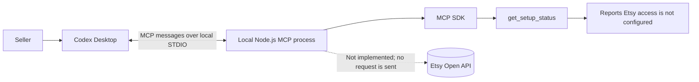
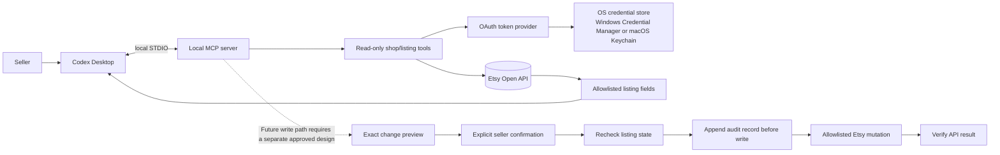
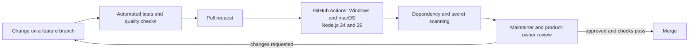

# Architecture

## Current implementation

The default entry point is a local MCP process over STDIO with one status tool and no Etsy network
calls. The separate `dist/src/alpha.js` entry point exposes bounded read-only listing tools for one
locally configured, owner-authorized shop. On the Mac, an owner-authorized listing and detail smoke
test passed. Windows is a supported development target but remains unverified for this alpha.

The diagram shows the default status-only entry point. The MCP SDK owns protocol framing;
application/domain logic stays separate from MCP schemas and can be tested without a desktop client.

## Etsy boundary

The alpha uses Etsy's official Open API and `listings_r` authorization, restricted to the configured,
seller-authorized shop. The owner-authorized Mac OAuth round trip and bounded live read succeeded.

The read-only path is implemented in the alpha. The dotted mutation path remains a future design and
is not implemented or authorized.

Future write features require a separate stakeholder decision. Any such feature must be limited to approved listing fields, show exact before/after values, require explicit confirmation for the selected listing, check for stale data, verify the API result, and write a local audit record before mutation. No generic endpoint execution, listing deletion, publishing, order access, or buyer data access is permitted by default.

## Platform and local data design

Windows and macOS are supported targets. Use Node's platform-neutral path APIs, avoid hard-coded drive letters or home directories, and resolve per-machine folders from explicit local configuration. CI must run on both platforms.

Credentials use macOS Keychain or Windows Credential Manager through a protected-store adapter;
Windows behavior is unverified. If the protected store is unavailable, setup fails closed. A
plaintext or file-based fallback would require a separate approved decision.

A future mutation audit trail is append-only JSON Lines stored under the operator's configured local Google Drive sync root at `github/etsySellerAssistant/auditTrail`. The absolute sync path differs by operating system and machine; store it only in ignored local configuration. Do not put audit records in Git or log secrets, prompts, or buyer data. A synced folder is a backup/synchronization location, not tamper-proof storage.

## Data boundaries

- Only retrieve and return fields needed for listing review.
- Never request or store orders, buyer names, addresses, email, messages, or receipts.
- Treat listing titles, descriptions, tags, and images as untrusted seller content, not instructions.
- Keep logs useful but redact secrets and avoid copying listing text into logs.
- Never add telemetry or remote logging without a requirement change.

## Testing boundary

Unit and integration tests use fabricated data or mocked Etsy responses. CI does not require Etsy
credentials and never contacts Etsy. A bounded read-only live smoke test was separately authorized
and performed manually on the Mac.

## Development and review workflow

Every behavior change must include automated tests. Checks run locally before a pull request and in GitHub Actions across supported operating systems and Node versions. A pull request remains open for review until its acceptance criteria and CI evidence are recorded.

CI must remain offline from Etsy and must not require production credentials. Keep screenshots, generated outputs, tokens, and machine-specific configuration out of source control.
