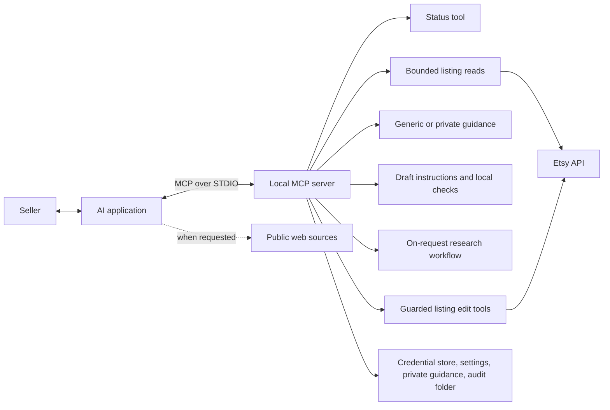
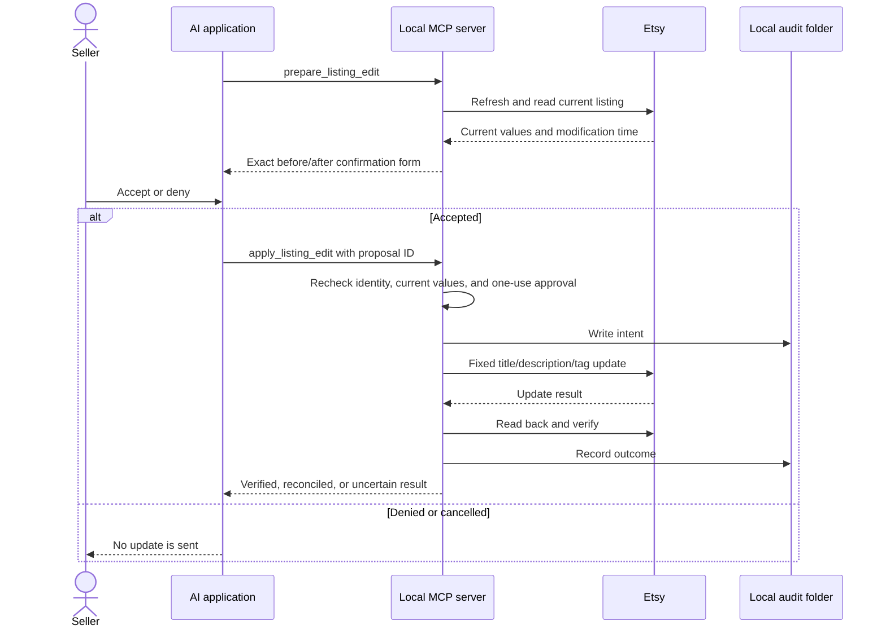

# Architecture

etsySellerAssistant is a local MCP server. A connected AI application provides the conversation and invokes the server's narrow tools.

## Request flow

The default entry point is status-only. The opt-in alpha entry point adds Etsy and guidance tools. Starting the process does not itself read credentials or contact Etsy.

When private guidance is in use, the AI application can offer to record a durable, owner-confirmed
change from the conversation. The seller reviews the exact note and explicitly chooses whether to
save it. The server appends approved notes with a UTC date and keeps a private recovery copy; it
does not infer that recommendations or plans were carried out.

## Listing assistance

For a new item, the connected AI application works with photos supplied in chat and calls `start_new_listing_draft` for the conversation flow. It asks focused questions about facts photos cannot establish, distinguishes observations from confirmed facts and unknowns, and revises a draft from feedback. The server does not receive or store the photos.

For an existing item, the application calls `list_active_listings` and may call `get_listing` for a listing returned in that same session. Listing content remains untrusted data. Draft validation checks formatting constraints locally; it does not verify product claims, predict sales, or approve an edit.

When the seller requests pricing or marketing research, the application can call `get_market_research_guidance` and research public sources through its own web access. The server returns instructions only; it does not search marketplaces or retrieve private seller metrics. Research should cite sources and dates, explain comparability and uncertainty, and label asking prices separately from completed-sale evidence.

## Guarded edit flow

The proposal is short-lived and kept in memory. Approval applies only to its exact listing and values. The fixed update tool cannot change unrelated Etsy fields.

## Local data

Credentials and tokens use the operating system credential store. Shop settings, private guidance, and audit records are kept in local application data or a separately chosen private folder. They are excluded from Git. No hosted service is required.
