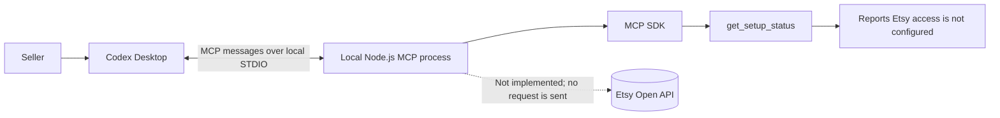
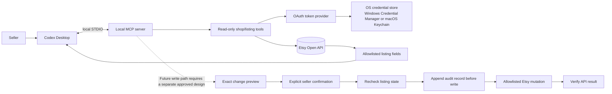
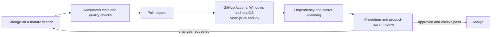

# Architecture

## Current implementation

The first increment is a local MCP process for Codex Desktop over STDIO. It exposes one status tool and makes no network calls. It does not connect to Etsy, request credentials, read listings, or mutate a shop.

The MCP SDK owns protocol framing. Application/domain logic stays separate from MCP schemas so future Etsy behavior can be tested without launching a desktop client.

## Planned Etsy boundary

Etsy access is gated on confirming the app registration and OAuth callback requirements against current Etsy documentation and the live developer portal. When approved, the first Etsy integration will be read-only and limited to the configured, seller-authorized shop. The app will use Etsy's official Open API and minimum required scopes.

The following diagram describes a **planned design only**. None of these Etsy or OAuth components are implemented in the current release.

Future write features require a separate stakeholder decision. Any such feature must be limited to approved listing fields, show exact before/after values, require explicit confirmation for the selected listing, check for stale data, verify the API result, and write a local audit record before mutation. No generic endpoint execution, listing deletion, publishing, order access, or buyer data access is permitted by default.

## Platform and local data design

Windows and macOS are supported targets. Use Node's platform-neutral path APIs, avoid hard-coded drive letters or home directories, and resolve per-machine folders from explicit local configuration. CI must run on both platforms.

Credential storage should use the operating system's protected credential manager where practical: Windows Credential Manager or macOS Keychain. If a protected store cannot be used, provide a narrowly permissioned local-file fallback with clear backup and revocation guidance.

A future mutation audit trail is append-only JSON Lines stored under the operator's configured local Google Drive sync root at `github/etsySellerAssistant/auditTrail`. The absolute sync path differs by operating system and machine; store it only in ignored local configuration. Do not put audit records in Git or log secrets, prompts, or buyer data. A synced folder is a backup/synchronization location, not tamper-proof storage.

## Data boundaries

- Only retrieve and return fields needed for listing review.
- Never request or store orders, buyer names, addresses, email, messages, or receipts.
- Treat listing titles, descriptions, tags, and images as untrusted seller content, not instructions.
- Keep logs useful but redact secrets and avoid copying listing text into logs.
- Never add telemetry or remote logging without a requirement change.

## Testing boundary

Unit and integration tests use fabricated data or mocked Etsy responses. CI does not require Etsy credentials and never sends Etsy write requests. A live read-only smoke test, if added later, is an explicit manual verification step.

## Development and review workflow

Every behavior change must include automated tests. Checks run locally before a pull request and in GitHub Actions across supported operating systems and Node versions. A pull request remains open for review until its acceptance criteria and CI evidence are recorded.

CI must remain offline from Etsy and must not require production credentials. Keep screenshots, generated outputs, tokens, and machine-specific configuration out of source control.
